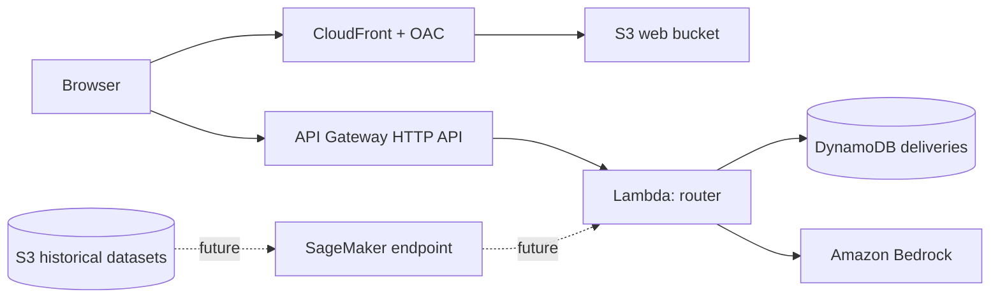

# Smart Logistics

[](https://github.com/dnnr1/smart-logistics/actions/workflows/ci.yaml)
[](https://github.com/dnnr1/smart-logistics/actions/workflows/infrastructure.yaml)

> AI-powered logistics intelligence platform built with TypeScript and AWS serverless services.

Smart Logistics helps logistics managers monitor deliveries, analyze operational performance,
estimate the risk of delivery delays, and obtain grounded insights from a Generative-AI
assistant. It is a full-stack, monorepo portfolio project demonstrating React, Node.js on AWS
Lambda, DynamoDB, CloudFormation, Amazon Bedrock, automated testing, and CI/CD.

> **Status:** under active implementation (see [Current limitations](#17-current-limitations)).
> All data in this repository is **fictional**.

## 1. Project overview

Smart Logistics is a logistics intelligence platform that centralizes delivery operations and
turns operational data into decisions. It is built as a serverless AWS application provisioned
entirely with CloudFormation.

## 2. Problem statement

Logistics operations generate large volumes of delivery data spread across carriers and regions.
Managers struggle to see the whole picture, react to delays early, and get quick answers to
operational questions without waiting on analysts.

## 3. Proposed solution

A single platform that:

- Monitors deliveries and statuses from the backend.
- Computes operational analytics (no hardcoded metrics).
- Scores delivery-delay risk with an **explainable heuristic** (SageMaker-ready).
- Answers grounded questions through a **Generative-AI assistant** (Amazon Bedrock, backend only).

## 4. Main features

- **Dashboard** — totals, in-transit, completed, delayed, success rate, status distribution,
  performance over time, recent activity (all from the API).
- **Delivery management** — list, search by tracking code, filter by status, details + history.
- **Risk analysis** — explainable risk score, level, contributing factors, recommended actions.
- **AI assistant** — grounded Q&A over real analytics; explicit unavailable state when Bedrock
  is not configured.

## 5. Technology stack

- **Frontend:** React, TypeScript, Vite, Tailwind CSS, React Router, TanStack Query, Recharts,
  Lucide React, Vitest, React Testing Library.
- **Backend:** Node.js, TypeScript, AWS Lambda, API Gateway HTTP API, AWS SDK v3, Zod, Vitest.
- **AWS:** Lambda, API Gateway, DynamoDB, S3, CloudFront, IAM, CloudWatch, CloudFormation,
  Bedrock (SageMaker as an optional future integration).
- **Tooling:** pnpm, Git, GitHub Actions, ESLint, Prettier, TypeScript strict mode.

## 6. Architecture



See [docs/architecture.md](docs/architecture.md) for the full design, domain model, API
contracts, and DynamoDB access patterns.

## 7. Repository structure

```
smart-logistics/
├── .github/workflows/        ci.yaml, infrastructure.yaml
├── apps/
│   ├── web/                  React SPA (Vite)
│   └── api/                  Lambda handlers + services
├── packages/
│   ├── domain/               Entities + pure logic (risk, analytics)
│   └── shared/               Shared types + Zod contracts
├── infrastructure/cloudformation/  main.yaml + templates/ + parameters/
├── data/samples/             Fictional seed dataset
├── docs/                     architecture, infrastructure, security, decisions
├── .env.example
└── ...
```

## 8. Local development

Prerequisites: Node.js ≥ 20, pnpm ≥ 10.

```bash
pnpm install
cp .env.example .env   # fill in as needed
pnpm dev:web           # start the web app (see scripts below)
```

Root scripts:

| Script                              | Description                          |
| ----------------------------------- | ------------------------------------ |
| `pnpm format` / `pnpm format:check` | Format / check formatting            |
| `pnpm lint`                         | ESLint                               |
| `pnpm typecheck`                    | TypeScript type checking (recursive) |
| `pnpm test`                         | Vitest (recursive)                   |
| `pnpm build`                        | Build all apps and packages          |

## 9. Environment configuration

Copy `.env.example` to `.env`. Key variables:

- `AWS_REGION`, `DYNAMODB_TABLE_NAME`
- `RISK_SCORER` (`heuristic` | `sagemaker`), `SAGEMAKER_ENDPOINT_NAME`
- `BEDROCK_MODEL_ID`, `BEDROCK_REGION` (empty disables the assistant → `503 AI_UNAVAILABLE`)
- `VITE_API_BASE_URL`

Never commit real secrets.

## 10. API documentation

Base contract: [docs/openapi.yaml](docs/openapi.yaml).

| Method | Path               | Description                     |
| ------ | ------------------ | ------------------------------- |
| GET    | `/deliveries`      | List/search/filter deliveries   |
| GET    | `/deliveries/{id}` | Delivery detail + history       |
| POST   | `/deliveries`      | Create delivery                 |
| GET    | `/analytics`       | Operational analytics           |
| POST   | `/predictions`     | Risk score (heuristic baseline) |
| POST   | `/assistant`       | Grounded AI assistant           |

## 11. Testing

```bash
pnpm test        # unit + integration tests (Vitest)
pnpm typecheck   # type checking
pnpm lint        # linting
```

Backend tests mock AWS services; frontend tests cover components, states, and API behavior.

## 12. GitHub Actions workflows

- **CI** (`.github/workflows/ci.yaml`): prettier → eslint → typecheck → test → build.
- **Infrastructure Validation** (`.github/workflows/infrastructure.yaml`): yamllint, cfn-lint,
  CloudFormation Guard, static security checks (no AWS credentials).

See [docs/infrastructure.md](docs/infrastructure.md) for branch protection and required checks.

## 13. CloudFormation deployment

```bash
aws cloudformation deploy \
  --template-file infrastructure/cloudformation/main.yaml \
  --stack-name smart-logistics \
  --parameter-overrides EnvironmentName=prod \
  --capabilities CAPABILITY_IAM
```

See [docs/infrastructure.md](docs/infrastructure.md). No SageMaker endpoints are created by default.

## 14. AWS services used

Lambda, API Gateway, DynamoDB, S3, CloudFront, IAM, CloudWatch, CloudFormation, Bedrock
(SageMaker planned).

## 15. Security considerations

See [docs/security.md](docs/security.md). No credentials in code/templates, least-privilege IAM,
S3 public access blocked + encryption, HTTPS only, input validation, grounded AI.

## 16. Estimated cost considerations

Most resources are on-demand/low-cost (Lambda, API Gateway, DynamoDB on-demand, S3, CloudFront).
Bedrock is billed per request. **No** SageMaker endpoints/notebooks/training jobs are created by
default to avoid substantial charges. See [docs/infrastructure.md](docs/infrastructure.md#cost).

## 17. Current limitations

- Risk scoring is an **explainable heuristic**, not a trained ML model.
- SageMaker integration is documented but not provisioned.
- Bedrock integration is implemented and unit-tested with mocks; live behavior is unverified
  without AWS credentials.
- CloudFormation is validated statically (cfn-lint); not deployed from this repository.
- GitHub branch protection must be configured manually (cannot be set from repo code).

## 18. Future improvements

- Train and deploy a SageMaker risk model; swap in `SageMakerRiskScorer`.
- Add authentication/authorization (Cognito).
- Add observability dashboards and alarms.
- Add more carriers/regions and richer analytics.

## License

[MIT](LICENSE). See [CONTRIBUTING.md](CONTRIBUTING.md).
