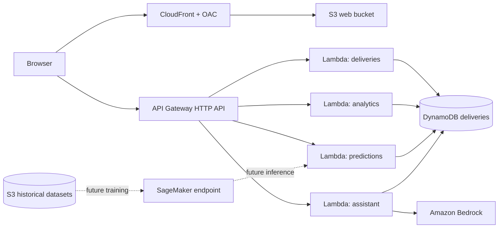
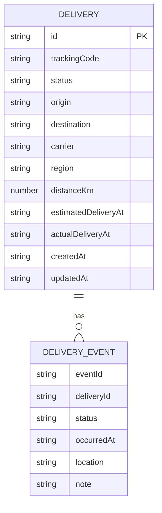

# Smart Logistics — Architecture

> Status: Phase 1 (design). This document describes the target architecture and the
> contracts the implementation follows. It is kept consistent with the code as the
> project evolves.

## 1. Context

Smart Logistics is an AI-assisted logistics intelligence platform. It lets logistics
managers monitor deliveries, analyze operational performance, estimate the risk of a
delivery being delayed, and ask a Generative-AI assistant grounded questions about the
operational data.

The platform is delivered as a **serverless AWS application** provisioned with
**CloudFormation**, with a **React** single-page frontend served from **S3 + CloudFront**
and a **Node.js/TypeScript** backend running on **AWS Lambda** behind **API Gateway HTTP
API**. Data is persisted in **Amazon DynamoDB**. Generative AI uses **Amazon Bedrock**.
The design is **SageMaker-ready**: the risk scorer is behind an interface so a trained
endpoint can replace the heuristic baseline without redesigning the application.

All data in the repository is **fictional**.

## 2. High-level architecture



### Components

| Component | Technology | Responsibility |
| --- | --- | --- |
| Web SPA | React, Vite, TypeScript, Tailwind, TanStack Query, Recharts | Dashboard, deliveries, analytics, risk, assistant UI |
| CDN | CloudFront + Origin Access Control | Serve the SPA from a private S3 bucket over HTTPS |
| API | API Gateway HTTP API | Routing, throttling, CORS |
| Compute | AWS Lambda (Node.js 20/22, TypeScript) | One handler module per resource group |
| Persistence | Amazon DynamoDB | Deliveries + access-pattern GSIs |
| AI | Amazon Bedrock | Generative assistant (backend only) |
| Data lake | Amazon S3 (historical) | Future dataset storage for SageMaker |
| ML (future) | Amazon SageMaker | Training + real-time inference endpoint |
| IaC | AWS CloudFormation (YAML, nested) | Reproducible infrastructure |
| CI | GitHub Actions | Lint, typecheck, test, build, cfn-lint |

## 3. Repository structure

```
smart-logistics/
├── .github/workflows/        ci.yaml, infrastructure.yaml
├── apps/
│   ├── web/                  React SPA (Vite)
│   └── api/                  Lambda handlers + services
├── packages/
│   ├── domain/               Entities, value objects, pure logic (risk, analytics)
│   └── shared/               Cross-cutting types, contracts, zod schemas
├── infrastructure/cloudformation/  main.yaml + templates/ + parameters/
├── data/samples/             Fictional seed dataset (JSON)
├── docs/                     architecture, infrastructure, security, decisions
├── .env.example
├── package.json              workspace root scripts
├── pnpm-workspace.yaml
└── ...
```

## 4. Backend layering (Clean Architecture, lightweight)

```
apps/api/src/
├── domain/            (re-exports packages/domain) entities & pure logic
├── application/       services: DeliveryService, AnalyticsService,
│                      PredictionService, AssistantService  (use interfaces)
├── infrastructure/    DynamoDeliveryRepository, BedrockAssistantGateway,
│                      config, logger
└── interfaces/        Lambda handlers (one per route) + http response mapper
```

Dependency rule: `interfaces` → `application` → `domain`. `application` depends on
**interfaces** (ports) for the repository and the AI gateway, which are implemented in
`infrastructure` and injected at composition time (dependency inversion). This keeps the
services unit-testable with in-memory fakes and lets the Bedrock/SageMaker backends be
swapped without touching business logic.

## 5. Domain model



### Enumerations

- `DeliveryStatus`: `pending | in_transit | out_for_delivery | delivered | delayed | cancelled`
- `RiskLevel`: `low | medium | high`

### Value objects / invariants

- `trackingCode` matches `^[A-Z0-9]{8,16}$`.
- `distanceKm >= 0`.
- `estimatedDeliveryAt` and timestamps are ISO-8601 strings.
- `actualDeliveryAt` present only when `status === delivered`.
- Status transitions are validated in the domain (`DELIVERY_STATUS_TRANSITIONS`).

## 6. API contracts

Base path: `/` (API Gateway HTTP API). JSON in/out. Consistent envelope:

```jsonc
// success
{ "data": { ... }, "meta": { "requestId": "...", "page": 1, "pageSize": 20, "total": 42 } }
// error
{ "error": { "code": "NOT_FOUND", "message": "...", "requestId": "..." } }
```

| Method | Path | Body / Query | Success | Errors |
| --- | --- | --- | --- | --- |
| GET | `/deliveries` | `?status&carrier&q&page&pageSize` | 200 list envelope | 400 validation |
| GET | `/deliveries/{id}` | path `id` | 200 delivery | 400, 404 |
| POST | `/deliveries` | DeliveryInput | 201 delivery | 400 |
| GET | `/analytics` | — | 200 analytics | 500 |
| POST | `/predictions` | `{ deliveryId }` or `DeliveryFeatures` | 200 risk result | 400, 404 |
| POST | `/assistant` | `{ question }` | 200 answer + sources | 400, 503 (AI unavailable) |

Validation uses **Zod** schemas in `packages/shared`. Errors are mapped centrally; internal
errors are logged with a request id and returned as a generic `INTERNAL` message.

## 7. DynamoDB access patterns

Single table `deliveries`. Keys:

- `PK` (partition): `DELIVERY#<id>` for the item, `DELIVERY#<id>#EVT#<eventId>` for events.
- `SK` (sort): `META` for the delivery root, `EVT#<occurredAt>` for events (so history is
  read in order with `ScanIndexForward`).

GSIs:

- `GSI1`: `PK1 = STATUS#<status>`, `SK1 = <createdAt>` → list/filter by status, newest first.
- `GSI2`: `PK2 = CARRIER#<carrier>`, `SK2 = <createdAt>` → carrier performance analytics.
- `GSI3`: `PK3 = REGION#<region>`, `SK3 = <createdAt>` → regional delay analytics.

| Access pattern | Index | Query |
| --- | --- | --- |
| Get delivery + history | Table | `PK = DELIVERY#<id>` |
| List by status (paged) | GSI1 | `PK1 = STATUS#<status>` |
| Search by tracking code | GSI4 (`trackingCode`) or scan with filter | `trackingCode = :code` |
| Carrier performance | GSI2 | `PK2 = CARRIER#<carrier>` |
| Regional delays | GSI3 | `PK3 = REGION#<region>` |

Design decisions are recorded in `docs/decisions/0002-dynamodb-single-table.md`.

## 8. Risk scoring (SageMaker-ready)

`RiskScorer` port with two implementations planned:

- `HeuristicRiskScorer` (Phase 6, default): transparent weighted score in `[0,100]` from
  distance, estimated transit, carrier historical delay rate, region delay rate, current
  status. Returns `{ score, level, factors[], actions[] }`. **Not a trained model.**
- `SageMakerRiskScorer` (future): calls a real-time endpoint; same output shape.

Selection is config-driven (`RISK_SCORER=heuristic|sagemaker`). See
`docs/decisions/0003-risk-scoring.md`.

## 9. AI assistant

`AssistantGateway` port; `BedrockAssistantGateway` implementation. The service:

1. Validates/sanitizes the question (Zod, length cap).
2. Builds a **grounded context** from real analytics (counts, delay rates by region/carrier).
3. Calls Bedrock `Converse`/`InvokeModel` with a system prompt that forbids inventing metrics
   and requires "insufficient data" answers.
4. Returns `{ answer, grounded: true, sources[] }`.

If Bedrock is not configured (`BEDROCK_MODEL_ID` empty / no AWS creds), the endpoint returns
`503 AI_UNAVAILABLE` and the UI shows a clear unavailable state. No simulated answers.

## 10. Frontend

React SPA with React Router. Pages: Dashboard, Deliveries (list + detail), Risk analysis,
Assistant. TanStack Query for server state; Recharts for charts; Tailwind for styling;
Lucide icons. All metrics come from the API — no hardcoded dashboard values. Vite dev server
proxies `/api` to the API Gateway/stage or a local server.

## 11. Security & responsible AI

See `docs/security.md`. Highlights: no credentials in code/templates, least-privilege IAM,
S3 public access blocked + encryption, HTTPS only, input validation, AI grounded + uncertainty
explicit, humans remain responsible for decisions.

## 12. Risks & dependencies

- AWS account/credentials may be unavailable → integration tested with mocks, clearly marked unverified.
- Bedrock model availability varies by region/account → model id is a parameter/env var.
- Heuristic risk is not a trained model → documented as demonstration baseline.
- GitHub branch protection cannot be set from repo code → documented as a manual step.